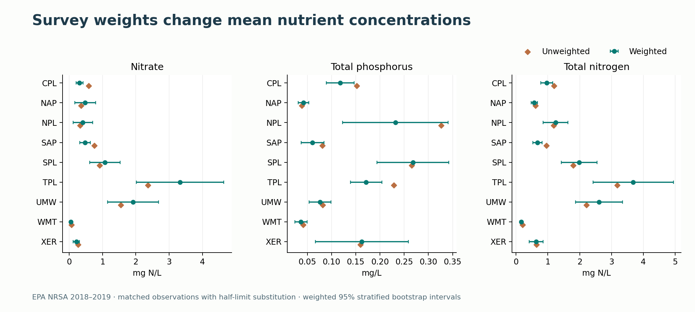
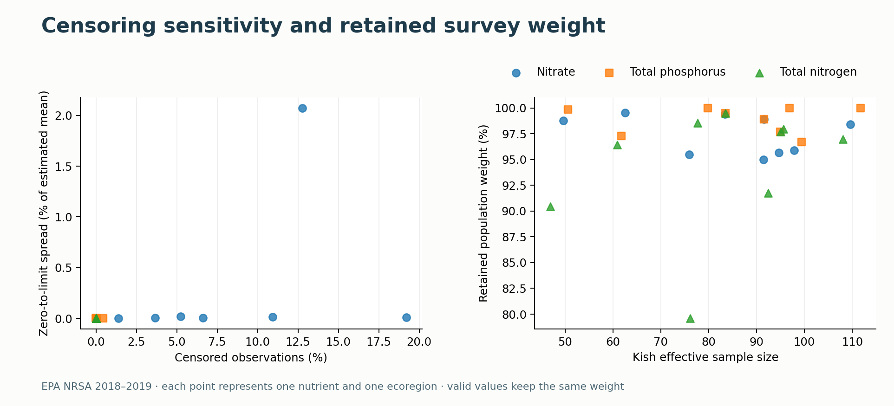
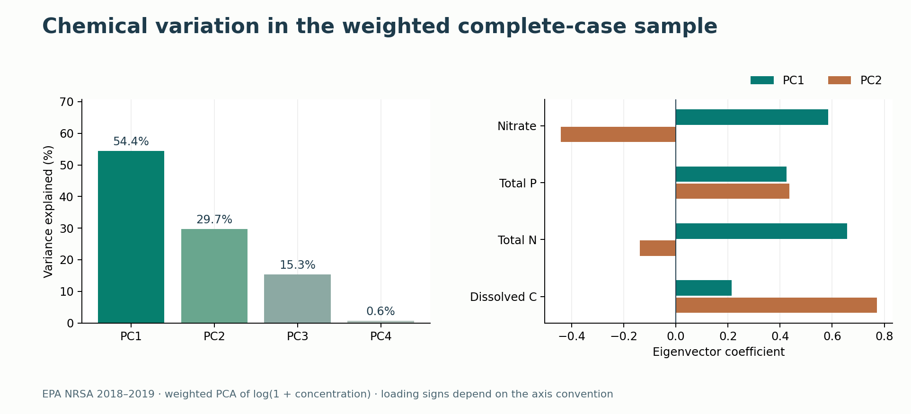

# Stream Nutrient Survey Inference

Compare station averages with length-weighted nutrient estimates from the 2018–2019 U.S. EPA National Rivers and Streams Assessment. The analysis uses the released population-estimate weights and tests how treatment of observations below detection changes the results.

## Data and design

The input includes six EPA files with checked SHA-256 fingerprints. All 1,851 eligible probability visits join by unique UID to site information and chemistry. The retained weights sum to about 1.543 million stream miles in the population-estimates file. The analysis uses the released weights, 48 design strata and nine reporting ecoregions.

The primary estimate substitutes half the detection limit for flagged non-detects and valid values below the method limit. Zero and full-limit substitutions provide sensitivity bounds. Q and H quality flags are excluded. Where laboratory flag combinations use commas and semicolons, both separators are normalized. A generic L flag can accompany a value above the detection limit. The assay results and units determine the interval. The Rao–Wu rescaled bootstrap uses 500 replicates within strata. It approximates design variance using the released fields. EPA’s official spatial-neighbourhood estimator uses a different variance method.

## Results

| Analyte | Valid stations | Censored | Unweighted mean | Weighted mean and 95% interval |
| --- | ---: | ---: | ---: | ---: |
| Nitrate, mg N/L | 1,814 | 108 | 0.8142 | 1.0341 [0.7511, 1.3171] |
| Total phosphorus, mg/L | 1,834 | 1 | 0.1429 | 0.1039 [0.0912, 0.1166] |
| Total nitrogen, mg N/L | 1,746 | 0 | 1.3072 | 1.3749 [1.1147, 1.6352] |

The national weighted nitrate means range from 1.0328 to 1.0354 mg N/L across the three substitutions. Available measurements represented 97.64% of the nitrate weight. The weighted PCA explained 54.41% of complete-case variation on PC1 and 29.67% on PC2. In the exploratory survey-weighted phosphorus model, the nitrate coefficient was 0.324 on the reported log-transformed scales, with a standard error of 0.099. Missingness can change the estimates. The model describes an association during this campaign.

[Quarto report](reports/report.html) · [National and ecoregion measures](reports/nutrient-estimates.csv) · [Design audit](reports/design-audit.csv) · [Source manifest](reports/source-manifest.json)

## Reproduce

Use R with the Survey package, Quarto and Python with NumPy and Matplotlib. R builds the results and their report tables. Quarto renders the included tables into a self-contained HTML file.

~~~powershell
Rscript -e 'install.packages("survey", repos="https://cloud.r-project.org")'
python -m pip install numpy==2.2.6 matplotlib==3.10.7
python fetch_nrsa.py
Rscript tests/test_nrsa.R
Rscript analyze.R
Rscript report_tables.R
quarto render report.qmd
python plot_results.py
~~~

The analysis credits the EPA and its state, tribal and federal partners. The public repository includes aggregate results and source fingerprints. [EPA data](https://www.epa.gov/national-aquatic-resource-surveys/data-national-aquatic-resource-surveys) · [EPA survey documentation](https://www.epa.gov/system/files/documents/2024-12/nrsa-2018-19-tsd-final-11252024.pdf)
